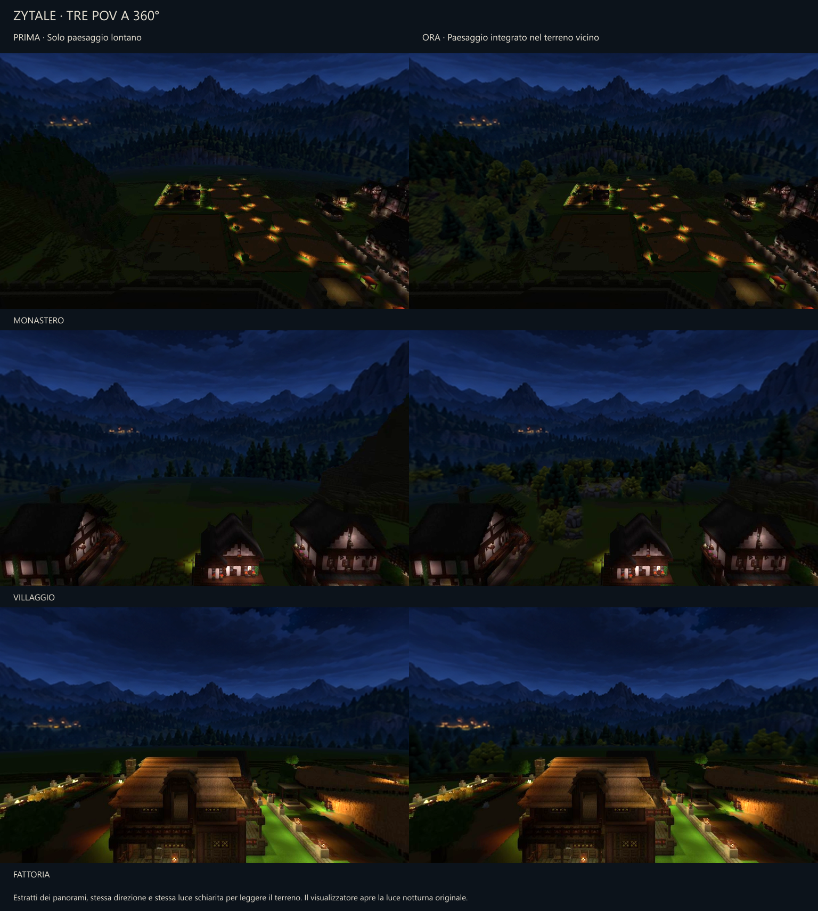

# Zytale — paesaggio approvato e tre POV a 360°

16 ottobre 2026. Stato: **simulazione visiva approvata dall’utente**, costruzione del paesaggio nel mondo non ancora avviata.

## Riferimento corrente

Il riferimento è la simulazione con terreno vicino in outputs/zytale-near-landscape-360-2026-10-16/. Conserva il **primo paesaggio lontano approvato**, tradotto in forme e materiali vicini a Hytale. La successiva variante con la cima del monte nascosta dalle nuvole è storica: l’utente ha preferito tornare al primo risultato.

Sequenza: rilievo nativo e primo fondale; variante del monastero con cima nascosta; ritorno al primo fondale; prova statica in stile in-game; richiesta esplicita di 360°; vista della fattoria a 360°; infine tre POV con vegetazione e rocce estese al terreno vicino. L’utente ha definito quest’ultimo lavoro «davvero vicino all’eccellenza» e ha chiesto di conservarlo in Forge e GitHub.

## Panorami approvati

- [Monastero — panorama 360°](landscape-360-2026-10-16/ZYTALE_MONASTERO_SIMULAZIONE_360.png)
- [Villaggio — panorama 360°](landscape-360-2026-10-16/ZYTALE_VILLAGGIO_SIMULAZIONE_360.png)
- [Fattoria — panorama 360°](landscape-360-2026-10-16/ZYTALE_FATTORIA_SIMULAZIONE_360.png)

Il confronto schiarisce entrambe le colonne allo stesso modo. Il visualizzatore apre la luce notturna originale.

## Rilievo e coordinate

Mondo osservato: **The Village - Zytale 306 Working Copy**, Hytale **0.7.2**, revisione d769dc3d57881261a62858e1394f0e4de9a21eca. Riprese del gioco locale, non del mondo recuperato. Nessuna posa/rimozione di blocchi nella fase visiva.

| POV | Coordinate effettive dei piedi | Contesto |
| --- | --- | --- |
| Monastero | 201, 190, 203 | In aria sopra chiesa e campanile |
| Villaggio | 37, 148, 6 | Sopra il municipio; bersaglio Rock_Slate_Brick_Roof a 37, 142, 5 |
| Fattoria | −49, 98,25, 224 | Colmo agricolo; correzione automatica +0,25 sulla Y richiesta 98 |

Nord = −Z; est = +X. Azimut del visualizzatore = −yaw Hytale modulo 360, verificato con bussola e Transform.getDirection installato. Nei PNG equirettangolari nord al centro, est a tre quarti, sud sui bordi congiunti. Offset ottico 1,7 usato solo per etichette indicative: non è una misura topografica.

Dieci sorgenti per punto: otto direzioni orizzontali più zenit/nadir. Catture 1920 × 1021, viewport circa 1920 × 1009, FOV verticale 90°, notte circa 00:10:08, nebbia attiva, Fullbright disattivato per la resa finale. Ispezioni supplementari con Fullbright hanno aiutato a leggere il terreno. Le quattro catture finali S/SW/W/NW della fattoria usarono distanza 704 per recuperare settori mancanti; le altre 672. Causa del caricamento incompleto non stabilita.

## Intervento e protezioni

Interventi nei margini esterni di fattoria e campi, nel terreno inutilizzato vicino alle case, nella foresta davanti al monastero e sui versanti fuori dalle mura. Vegetazione, affioramenti e arbusti raccordano il primo piano allo scenario lontano. Edifici, coltivazioni, cortili, ponte, strade e accessi sono esclusi dalle maschere.

Prompt e guida colorata non garantivano la conservazione dell’intera immagine: gli output grezzi cambiavano anche luce e zone protette. Il risultato ripristina la base fuori dalle maschere e sfuma solo al loro interno. Verificati **zero pixel modificati fuori dalle zone consentite** in ciascuna delle tre integrazioni vicine. È un controllo sulle immagini, non una certificazione dei confini giocabili 3D.

Le viste condividono fondale e piano ambientale. I nuovi singoli alberi e le rocce sono indicativi: non provengono da geometria 3D comune. Sorgenti generate native 1774 × 887, ricampionate nelle composizioni finali 4096 × 2048.

## Consegna e verifiche

Cartella locale: C:/Users/User/Desktop/Zytale/outputs/zytale-near-landscape-360-2026-10-16/.

- **ZYTALE_TERRITORIO_INTEGRATO_360_VIEWER.html**: autonomo, tre POV e tre panorami nativi incorporati; trascinamento, zoom, bussola, riferimenti, confronto Hytale e “Schiarisci vista”. La luce agisce sull’immagine, non sul Fullbright del motore.
- Tre PNG 4096 × 2048, copertura 360° × 180°; confronto; prompt, maschere e note.
- **ZYTALE_TRE_POV_360_TERRITORIO_INTEGRATO.zip**: 44.628.012 byte, 17 file, CRC32 e SHA-256 dei contenuti verificati. SHA-256: cc7d3d926bf84f0a4f86bc797ce807c100f2c55816fc2fdb9cb4fb5d5d03b4a2.
- Dodici viste prospettiche e sei confronti della base controllati visivamente. Sei immagini incorporate verificate per dimensioni/hash; sintassi e identificativi UI controllati.
- I **23 controlli interattivi riusciti** appartengono al visualizzatore originale (Edge headless 155.0.4283.45, software WebGL). Il nuovo HTML conserva rendering/caricamento e controlli di movimento; cambiano testi, dati, viste iniziali e luce. **Nessun nuovo collaudo interattivo nel browser**: una successiva apertura file locale è stata rifiutata dalla policy browser; il blocco non è stato aggirato. Il vecchio timing non misura prestazioni Hytale.

[Evidenze numeriche e immagini](landscape-360-2026-10-16/). Memoria tecnica: EXP-000009, SOL-000009 v001/v002, FAIL-000029. I grandi HTML/ZIP duplicati restano negli output locali; le immagini approvate e le verifiche essenziali sono versionate qui.

## Ripristino della precedente ispezione

Posizione e rotazione originali ripristinate; impostazioni grafiche salvate confrontate con quelle iniziali, compresi FOV 75, Fullbright attivo e distanza 672. La persistenza della ripresa del tempo resta **non confermata**: UI sbloccata ma ultimo dato salvato letto ancora in pausa. L’ulteriore controllo nativo fu interrotto dall’utente con Esc; le successive modifiche alle immagini non hanno riaperto il gioco. Non trasformare questi limiti storici in verifiche riuscite.

## Nuovo ZIP della mappa

Riferimento aggiuntivo per la futura costruzione:

- C:/Users/User/AppData/Roaming/Hytale/UserData/Saves/The Village - Zytale 306 Working Copy.zip
- 307.794.515 byte; ultima scrittura UTC 2026-10-16 11:45:13.
- SHA-256: 722afab63b514f7cde1953fe42205c75d40f1977ea5dfa572235a15f668f420a.
- 10.850 voci ZIP, 15 file region, una radice con il nome del mondo; UUID dal config: 47e0eb88-cba8-4c24-8b4d-822e99e86b60.
- Verifiche: impronta dell’intero file, elenco centrale e config. Nessuna estrazione, ricostruzione o verifica CRC completa dello ZIP. Il salvataggio non è pubblicato in questa annotazione.

## Richiesta successiva: requisito, non soluzione già implementata

L’utente vuole un **prompt per Codex** per realizzare il paesaggio nel gioco e ha chiesto di confermare la comprensione prima di scriverlo.

**Vicino:** ricostruzione fisica fedele nelle immediate vicinanze di fattoria, campi, villaggio, foresta e monastero, preservando gli spazi giocabili, le strutture e gli accessi esistenti.

**Lontano:** costruire solo quanto serve a restituire il risultato visivo dei POV. Valutare profondità ridotta, prospettiva forzata, creste/sagome semplificate e parti nascoste omesse, anziché costruire letteralmente tutta l’estensione suggerita dall’immagine. Sono opzioni da verificare nel motore, non tecniche già provate qui.

Il futuro risultato dovrà funzionare dai tre POV e durante gli spostamenti nelle aree giocabili: verificare parallasse, occlusioni, skyline, viste da terra e costo di rendering. Il brief è stato riformulato all’utente; alla registrazione il prompt esecutivo non è ancora stato scritto e il nuovo paesaggio non è costruito.
